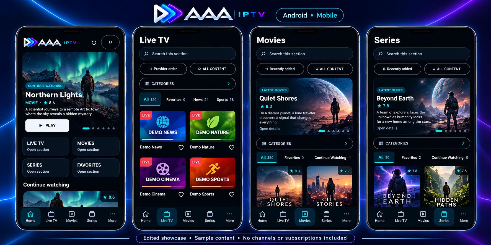
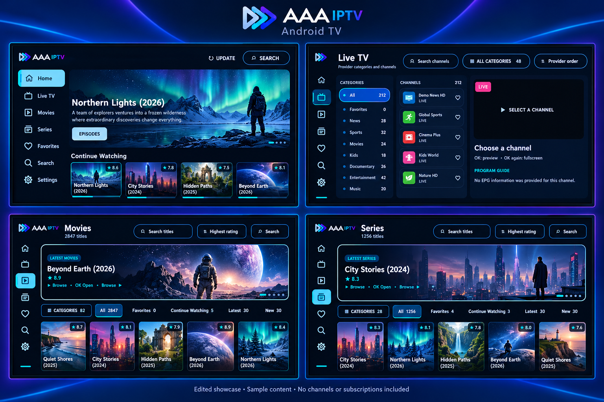

# AAA IPTV

A media player for Android phones and Android TV, with a separately developed Windows desktop edition.

**Bring your own authorized source.** AAA IPTV does not include channels, subscriptions, movies or a streaming catalogue.

## Downloads

| Platform | Version | Download |
| --- | --- | --- |
| Windows x64 — Setup (recommended) | 1.2.2 | [Download installer](https://github.com/aaa-software-studio/aaa-iptv-showcase/releases/download/windows-v1.2.2/AAA-IPTV-PC-1.2.2-Setup-x64.exe) |
| Windows x64 — Portable | 1.2.2 | [Download Portable](https://github.com/aaa-software-studio/aaa-iptv-showcase/releases/download/windows-v1.2.2/AAA-IPTV-PC-1.2.2-Portable-x64.exe) |
| Android phones and Android TV | 2.15.0 · build 80 | [Download signed APK](https://github.com/aaa-software-studio/aaa-iptv-showcase/releases/download/android-v2.15.0/AAA-IPTV-2.15.0-Android-TV.apk) |

[Windows release, checksums, licenses and third-party sources](https://github.com/aaa-software-studio/aaa-iptv-showcase/releases/tag/windows-v1.2.2) · [Android/TV release and checksums](https://github.com/aaa-software-studio/aaa-iptv-showcase/releases/tag/android-v2.15.0)

**Windows executables are unsigned.** Verify downloads against the checksum file. A matching checksum is an integrity check, not an antivirus or security certification. Do not disable antivirus or Play Protect to install the app.

Portable runs without installation but shares the application data profile by default. Setup and Portable are not isolated accounts or separate libraries.

## Android and Android TV

Version **2.15.0**, build **80**. One signed APK serves phones and TVs. Requires Android 6.0 or later; playback support depends on your device and source.

Download the signed APK from [Android / TV 2.15.0 releases](https://github.com/aaa-software-studio/aaa-iptv-showcase/releases/tag/android-v2.15.0). Install it with Android’s package installer. For a compatible existing installation, choose **Update** and keep your data. Keep Play Protect enabled; signing does not guarantee the absence of installation scans or warnings.

- Import authorized Xtream accounts, M3U playlists or supported direct media URLs.
- Browse live TV, movies and series supplied by your source.
- Search, manage favorites and continue watching.
- Touch and TV navigation layouts, with audio/subtitle controls supported by the media.
- English/Persian Android interface and light/dark/system themes.

Xtream short EPG is supported; general XMLTV import and automatic application updates are not implemented. Compatibility with every provider, codec or device is not guaranteed.

## Gallery

These AI-edited showcase images are based on the application interface. Titles, artwork and catalogue data are illustrative replacements. They are not unmodified screenshots or a content offer.

### Android


### Android TV


### Windows desktop — updated interface

Windows **1.2.2** is available as Setup and Portable. Settings includes Playback, Subtitles, Appearance, Storage and About. Successful Windows use of both packages has been reported; this is not exhaustive device, installation or codec testing. The gallery is based on the updated 1.2.1 interface retained in 1.2.2.

The following promotional images are AI-edited from the updated interface. Framing and illustrative catalogue artwork have been changed; these are not unaltered screenshots. No channels, movies or subscriptions are included.


#### Settings

Playback preferences, subtitle styling, appearance, temporary-cache management and version information are grouped in the main-menu Settings panel.


## راهنمای سریع فارسی

### دانلود و نصب
- **ویندوز:** برای استفادهٔ معمول Setup را انتخاب کنید. Portable بدون نصب اجرا می‌شود؛ داده‌های آن به‌صورت پیش‌فرض از پروفایل مشترک برنامه استفاده می‌کنند.
- **اندروید و Android TV:** یک APK مشترک برای هر دو وجود دارد؛ حداقل Android 6.0 لازم است. اگر نسخهٔ سازگار قبلی نصب است، Update را انتخاب کنید. حذف برنامه ممکن است داده‌های محلی را پاک کند.
- فایل‌های ویندوز امضای دیجیتال ندارند. هش فایل را بررسی کنید و هشدار امنیتی را خودکار اشتباه فرض نکنید.
- بخش **Source code** که GitHub خودکار می‌سازد، فایل نصبی نیست و سورس اختصاصی برنامه را در بر ندارد.

### افزودن منبع و شروع پخش
برنامه کانال، اشتراک یا فیلم همراه ندارد. از بخش افزودن یا مدیریت حساب، اطلاعات منبع مجاز خود را وارد کنید. اندروید از حساب Xtream، فهرست M3U و لینک مستقیم پشتیبانی‌شده استفاده می‌کند؛ در ویندوز گزینه‌های موجود در فرم حساب برنامه را دنبال کنید. سپس از Live TV، Movies یا Series محتوای منبع را انتخاب کنید.

اطلاعات ورود و آدرس فهرست را برای دیگران نفرستید. اگر پخش شروع نشد، اتصال، اعتبار حساب و دسترسی به منبع را بررسی کنید؛ سازگاری با همهٔ منابع و کدک‌ها تضمین نشده است.

### زیرنویس و تنظیمات ویندوز
در **Settings → Subtitles** فونت، اندازه، رنگ، موقعیت و تأخیر را تنظیم کنید. وجود زیرنویس داخلی به فایل یا پخش انتخابی بستگی دارد. دانلود آنلاین زیرنویس در نسخهٔ فعلی ویندوز غیرفعال است. تنظیمات پخش، اتصال مجدد و شتاب‌دهی سخت‌افزاری در **Settings → Playback** قرار دارند.

### بررسی سلامت دانلود
فایل **SHA256SUMS.txt** را از همان صفحهٔ نسخه بگیرید. در PowerShell، با نام فایل دانلودشده اجرا کنید و نتیجه را با مقدار فایل مقایسه کنید:

```powershell
Get-FileHash ".\AAA-IPTV-PC-1.2.2-Setup-x64.exe" -Algorithm SHA256
Get-FileHash ".\AAA-IPTV-PC-1.2.2-Portable-x64.exe" -Algorithm SHA256
Get-FileHash ".\AAA-IPTV-2.15.0-Android-TV.apk" -Algorithm SHA256
```

اگر مقدار متفاوت بود فایل را اجرا نکنید و دوباره از صفحهٔ رسمی دانلود کنید. هش مشابه، تضمین بی‌نقص‌بودن یا تأیید امنیتی مستقل نیست.

## Support / پشتیبانی

[Report a bug or suggest a feature / گزارش مشکل یا پیشنهاد قابلیت](https://github.com/aaa-software-studio/aaa-iptv-showcase/issues/new/choose)

Include the app version, device/OS and steps to reproduce. Public reports must not contain passwords, account usernames, provider/playlist URLs, tokens or unredacted logs/screenshots. Use fictional examples; catalogue and credentials are not needed to request help.

گزارش‌ها عمومی‌اند. رمز، نام کاربری حساب، لینک سرور یا پلی‌لیست و اطلاعات شخصی را وارد نکنید؛ قبل از ارسال تصویر یا لاگ، اطلاعات حساس را حذف کنید. زمان پاسخ‌گویی تضمین‌شده نیست.

## Privacy

Sources, preferences, catalogue caches, favorites and viewing history are stored locally. The Android implementation uses platform-keystore-backed protection for stored connection data; this is not a comprehensive security certification. Media, artwork and connection requests go to the hosts associated with the source you import. Prefer HTTPS: HTTP does not protect credentials or media in transit. Optional Android speed diagnostics may contact Cloudflare and read your provider stream when invoked.

No personal account or private playlist is bundled. See [third-party notices](THIRD-PARTY-NOTICES.txt).

## Project

Built by AAA Software Studio from the creator’s idea with AI assistance. First-party source is maintained privately. This showcase repository does not grant a source-code license. Third-party components retain their respective licenses.

