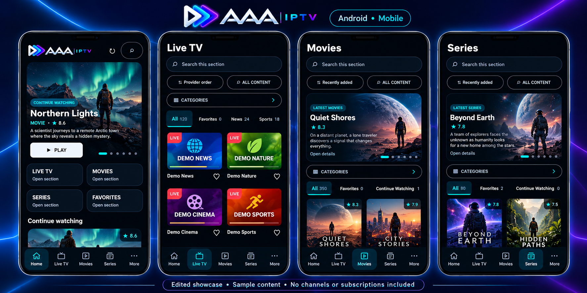
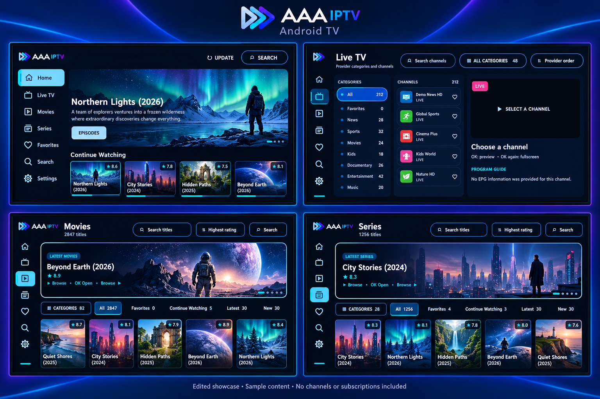
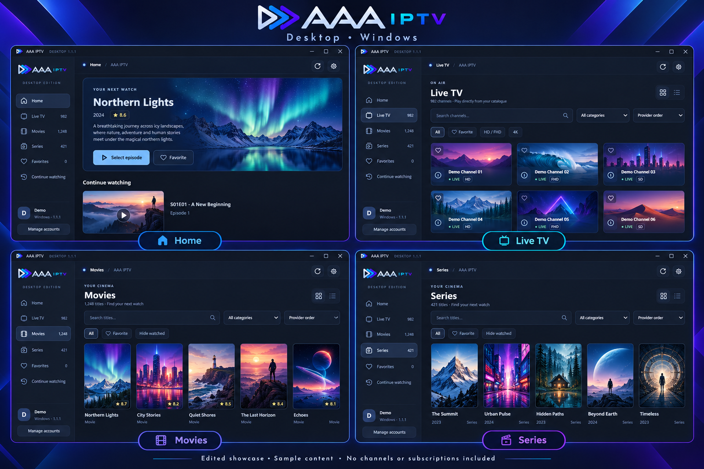

# AAA IPTV

A media player for Android phones and Android TV, with a separately developed Windows desktop edition.

**Bring your own authorized source.** AAA IPTV does not include channels, subscriptions, movies or a streaming catalogue.

## Android and Android TV

Version **2.15.0**, build **80**. One signed APK serves phones and TVs. Requires Android 6.0 or later; playback support depends on your device and source.

Download the signed APK from [Android / TV 2.15.0 releases](https://github.com/aaa-software-studio/aaa-iptv-showcase/releases). Install it with Android’s package installer. For a compatible existing installation, choose **Update** and keep your data. Keep Play Protect enabled; signing does not guarantee the absence of installation scans or warnings.

- Import authorized Xtream accounts, M3U playlists or supported direct media URLs.
- Browse live TV, movies and series supplied by your source.
- Search, manage favorites and continue watching.
- Touch and TV navigation layouts, with audio/subtitle controls supported by the media.
- English/Persian Android interface and light/dark/system themes.

Xtream short EPG is supported; general XMLTV import and automatic application updates are not implemented. Compatibility with every provider, codec or device is not guaranteed.

## Gallery

These AI-edited showcase images are based on the application interface. Titles, artwork and catalogue data are illustrative replacements. They are not unmodified screenshots or a content offer.

### Android

### Android TV

### Windows desktop showcase

The Windows 1.1.1 English interface has been tested by the creator. Its download is withheld while bundled third-party redistribution requirements are completed. No Windows executable is included in this release.

## Privacy

Sources, preferences, catalogue caches, favorites and viewing history are stored locally. The Android implementation uses platform-keystore-backed protection for stored connection data; this is not a comprehensive security certification. Media, artwork and connection requests go to the hosts associated with the source you import. Prefer HTTPS: HTTP does not protect credentials or media in transit. Optional Android speed diagnostics may contact Cloudflare and read your provider stream when invoked.

No personal account or private playlist is bundled. See [third-party notices](THIRD-PARTY-NOTICES.txt).

## Project

Built by AAA Software Studio from the creator’s idea with AI assistance. First-party source is maintained privately. This showcase repository does not grant a source-code license. Third-party components retain their respective licenses.
